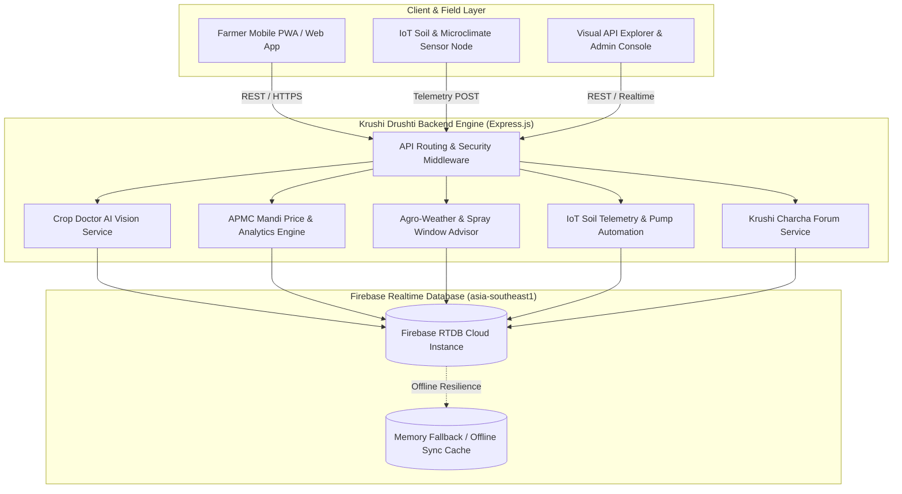

# Krushi Drushti (कृषी दृष्टी) — AI-Powered Smart Agriculture Backend

> Autonomous AgriTech platform backend engineered with **Firebase Realtime Database**, Edge Vision disease diagnostics, hyperlocal agro-weather advisories, live APMC Mandi price analytics, farmer community (Krushi Charcha), and automated IoT smart irrigation telemetry.

---

## 🌾 Overview & Firebase Integration

Krushi Drushti connects directly to Google Firebase Realtime Database:
- **Firebase Project ID**: `krushi-drishti`
- **Database Instance**: `krushi-drishti-default-rtdb`
- **Target Regional Endpoint**: `https://krushi-drishti-default-rtdb.asia-southeast1.firebasedatabase.app`
- **Console URL**: `https://console.firebase.google.com/project/krushi-drishti/database/krushi-drishti-default-rtdb/data/~2F`

---

## 🏛️ System Architecture



---

## 🗄️ Database Data Models

| Firebase Node | Description | Key Indexes (`.indexOn`) |
| :--- | :--- | :--- |
| `/system` | Platform metadata, version, health status, and sync timestamp. | - |
| `/farmers` | Registered farmer profiles, landholdings (acres), soil type, irrigation source. | `phone`, `district`, `state` |
| `/crops` | Master catalog of Indian crops with nutrient & disease guidelines. | `category`, `season` |
| `/diagnostics` | Crop disease detection history, confidence scores, vernacular remedies (EN/HI/MR). | `farmerId`, `crop`, `severity`, `timestamp` |
| `/mandi_prices` | APMC market commodity rates, daily min/max/modal prices (₹/Quintal), and trends. | `commodity`, `state`, `district`, `market` |
| `/weather_advisories` | Hyperlocal weather forecasts, humidity, rain probability, and spraying window. | `district`, `state`, `timestamp` |
| `/community` | Krushi Charcha farmer discussion threads, verified agronomist solutions, upvotes. | `category`, `timestamp`, `authorId` |
| `/schemes` | Central & State agricultural subsidies (PM-KISAN, PMFBY, PM-KUSUM solar pumps). | `category`, `targetAudience` |
| `/sensor_telemetry` | Farm IoT telemetry: soil moisture %, temperature, humidity, pump trigger state. | `farmerId`, `deviceId`, `timestamp` |

---

## 🚀 Quick Start Guide

### 1. Prerequisites
- Node.js (v18+)
- npm (v9+)

### 2. Environment Setup
Create a `.env` file from `.env.example`:
```env
PORT=5000
NODE_ENV=development
FIREBASE_PROJECT_ID=krushi-drishti
FIREBASE_DATABASE_NAME=krushi-drishti-default-rtdb
FIREBASE_DATABASE_URL=https://krushi-drishti-default-rtdb.asia-southeast1.firebasedatabase.app

# Pl@ntNet Vision API Key
PLANTNET_API_KEY=2b1012WAXF1ObK4K1nMcYJuRO
PLANTNET_PROJECT=k-indian-subcontinent
```

### 3. Install & Seed
```bash
npm install
npm run seed     # Populates the live Firebase RTDB with authentic Indian agricultural data
```

### 4. Run Development Server
```bash
npm start        # Launches the API and Visual Explorer on http://localhost:5000
```

### 5. Run Automated Tests
```bash
npm test         # Executes automated verification test suite
```

---

## 📡 REST API Reference

### Authentication & Farmer Profile
- `POST /api/auth/register` — Register a new farmer and securely store credentials & profile in Firebase Realtime Database (`/users` & `/farmers`).
- `POST /api/auth/login` — Validate farmer credentials against Firebase RTDB and initiate session.
- `GET /api/auth/profile/:id` — Fetch live farmer profile and farm metadata.

### Health & System
- `GET /api/health` — Check server status, Firebase RTDB connection, and round-trip latency.

### Crop Doctor & AI Diagnostics
- `POST /api/diagnose` — Run AI diagnostic analysis on crop leaves/symptoms and generate English, Hindi, and Marathi prescriptions.
- `GET /api/diagnose/history?farmerId=farmer_001` — Retrieve diagnostic scan history.

### Mandi APMC Market Prices
- `GET /api/mandi?commodity=Onion&district=Nashik` — Query APMC market rates with filters.
- `GET /api/mandi/analytics/:commodity` — Calculate average modal price, highest paying market, and price spread.
- `POST /api/mandi` — Submit an APMC price arrival record.

### Agro-Weather & Spray Safety
- `GET /api/weather?district=Nashik` — Hyperlocal weather advisories for agricultural districts.
- `POST /api/weather/spray-check` — Real-time spray safety window evaluator based on temperature, rain probability, and wind.

### Farmers & Farm IoT
- `GET /api/farmers` — List all registered farmers.
- `POST /api/farmers` — Register a new farmer profile.
- `GET /api/telemetry` — Retrieve IoT sensor telemetry nodes.
- `POST /api/telemetry` — Ingest sensor packet and automatically evaluate smart irrigation relay triggers.

### Krushi Charcha Community
- `GET /api/community` — Fetch community discussions.
- `POST /api/community` — Post a new farmer query.
- `POST /api/community/:id/like` — Upvote a discussion.
- `POST /api/community/:id/reply` — Submit an agronomist reply.

### Government Schemes
- `GET /api/schemes` — Subsidies, PM-KISAN, PMFBY, and solar pump eligibility.

---

## 🔒 Security & Firebase Rules
Production security rules configured in [`database.rules.json`](file:///e:/Krushi-Drishti/database.rules.json).

---

## 👥 Autonomous Team Charter
Built according to [`AGENTS.md`](file:///e:/Krushi-Drishti/AGENTS.md) standards by:
- **Lead Product Manager (`product-manager`)**
- **Lead UI/UX Designer (`ui-ux-designer`)**
- **Principal Architect (`architect`)**
- **Senior Full-Stack Engineer (`fullstack-dev`)**
- **Staff QA Engineer (`qa-engineer`)**
- **Principal Security Auditor (`security-auditor`)**
- **CodeRabbit Reviewer (`coderabbit-review`)**
